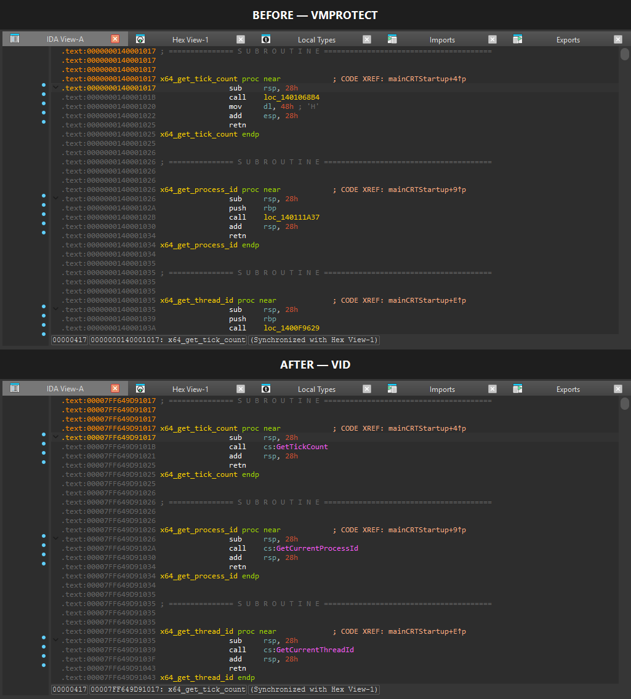

# vid

`vid` (old name is VMP-Imports-Deobfuscator) reconstructs VMProtect-obfuscated PE imports from a live Windows process and writes a readable, loadable PE image with a new import table.

The tool is intentionally narrow: it repairs imports and the instructions that reference them. It is not a generic unpacker and does not devirtualize protected application logic.

## Build

From the repository root:

```powershell
rustup show
cargo build --release
.\target\release\vid.exe --help
```

The resulting executable is written to `target\release\vid.exe`.

## Quick start

Start or attach to the protected program and let VMProtect finish initializing its protected imports. Then inspect the available sections:

```powershell
.\target\release\vid.exe --pid 10856 --list-sections
```

If one to three executable sections have entropy above `7.0`, `vid` can select them automatically:

```powershell
.\target\release\vid.exe --pid 10856 --new-entry-rva 0x1000
```

For `sample.exe`, the default output name is `sample.vid.exe`. `--new-entry-rva` changes `AddressOfEntryPoint` in the rebuilt file only; it does not resume or otherwise change the live process.

## Command-line reference

```text
vid.exe --pid <PID> [OPTIONS]
```

| Option | Description |
|---|---|
| `--pid <PID>` | Required non-zero target process ID. |
| `--module <NAME>` | Inspect a loaded module instead of the main executable. Matching is case-insensitive and accepts a file name, extensionless name, or path. |
| `--vm-sections <SECTION>...` | Select one to three executable VM sections using either 1-based numbers or names. Names and numbers cannot be mixed. |
| `--list-sections` | Print section numbers, names, RVAs, sizes, permissions, characteristics, and entropy, then exit. |
| `--section-name <NAME>` | Name of the rebuilt import section. Default: `.vid`. Must be 1–8 printable ASCII bytes. |
| `--output <PATH>` | Explicit output path. Missing parent directories are created automatically. The inspected module cannot be overwritten. |
| `--new-entry-rva <RVA>` | New output entry RVA in decimal or `0x`-prefixed hexadecimal. It must point into an executable section. |
| `-h`, `--help` | Show command help. |
| `-V`, `--version` | Show the version. |

`--list-sections` can be combined with `--module`, but conflicts with options that modify the output.

## Examples

### Select VM sections by number

```powershell
.\target\release\vid.exe `
    --pid 10856 `
    --vm-sections 4 6 `
    --new-entry-rva 0x1000 `
    --output .\dump\sample.rebuilt.exe
```

### Select VM sections by name

Quote names that contain PowerShell metacharacters:

```powershell
.\target\release\vid.exe `
    --pid 10856 `
    --vm-sections '._*f' '.]zF' `
    --section-name .vidiat `
    --new-entry-rva 4096
```

### Rebuild a DLL loaded in another process

```powershell
.\target\release\vid.exe `
    --pid 10856 `
    --module protected-plugin.dll `
    --vm-sections .vmp0 .vmp1 `
    --output .\dump\protected-plugin.rebuilt.dll
```

## What gets repaired

| Protected behavior | Rebuilt form |
|---|---|
| VM stub ultimately calls an import and returns | `call [IAT]` |
| VM stub removes the caller return and transfers permanently | `jmp [IAT]` |
| VM stub returns an imported address in a register | `mov reg, [IAT]` |
| Existing x86 absolute IAT operand | Same instruction with the rebuilt absolute IAT address |
| Existing x64 RIP-relative IAT operand | Same instruction with a new RIP-relative displacement |
| Random protected bytes after a rewritten transfer | Explicit jump to the proven continuation; unreachable residue is left untouched |

## Before and after

This screenshot was captured from IDA Pro 9.3 using a real x64 MASM executable with PDB information. The executable was processed by VMProtect Ultimate 3.9.4 build 2285 with Import Protection enabled, recovered from its running process by `vid`, and launched successfully after rebuilding.

Absolute image bases differ because the protected process was captured after ASLR. In both halves, the functions remain at the same RVAs beginning at `0x1017`.

The upper half shows the protected calls, including generated stack operations and residue. The lower half shows the corresponding direct RIP-relative IAT calls while preserving each function's continuation:



## Troubleshooting

### VM recovery is partial

```text
[warn] Partial VM recovery | rewritten 2233 of 2332 | left unchanged 99 | unresolved destinations 1
[warn] Direct VM rewrites | applied 2232 of 2233 | left unchanged 1
[warn] Conventional rewrites | applied 133 of 134 | covered by protected rewrites 1
```

The first warning means emulation could not prove the import or continuation for every protected transfer. The second means an import was identified, but its direct IAT instruction could not fit safely at the original location or reproduce the observed stack effect. The third reports conventional references that occupied bytes replaced by a proven protected rewrite; those bytes are patched only once. All applicable transfers are rebuilt and unresolved instructions remain unchanged in the output image. Common causes are capturing the process before VMProtect initializes its imports, selecting the wrong VM section, or encountering an unsupported stub form. Let the process reach stable original code and verify the selected sections if the remaining protected transfers matter for execution. `--new-entry-rva` changes only the rebuilt file and cannot advance the live target.

If no import can be recovered at all, there is no import table to build and `vid` stops without writing an output file.

### No automatic VM section is selected

Run:

```powershell
.\target\release\vid.exe --pid 10856 --list-sections
```

Then pass one to three executable section numbers or names with `--vm-sections`.

### Access is denied

Run `vid` at the same integrity level as the target. Protected or elevated processes may require an elevated terminal. The tool intentionally requests only process query and memory-read permissions.

## Limitations

- The target must remain alive and its protected import state must be initialized and stable while the snapshot is read.
- Only x86 and x64 PE images are supported.
- At most three VM sections can be selected in one run.
- A protected transfer is patched only when a direct rewrite is proven. Unresolved transfers remain unchanged while the rest of the image is rebuilt.
- `vid` does not bypass anti-debugging, suspend the target, repair arbitrary packer damage, preserve overlays, or devirtualize protected program code.

## License

MIT License. See [LICENSE](LICENSE).
